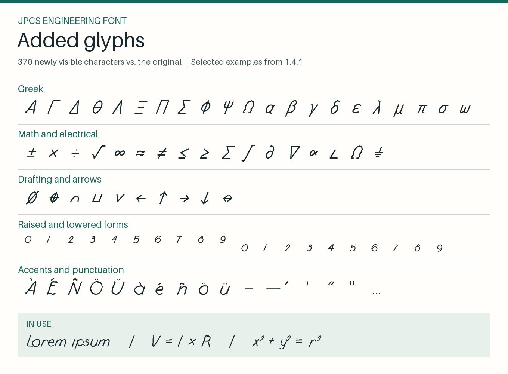

# JPCS Engineering Font

A handwritten engineering lettering font extended with Greek letters, accented Latin, mathematical and electrical symbols, drafting marks, and superscripts and subscripts. The original font is credited to **Junior Philippine Computer Society – Mapua Chapter**.

## Font preview


## Added glyphs



Version 1.4.1 maps **465 Unicode characters**. Compared with the original, **370 gained drawable outlines**: 256 were mapped to blank glyphs and 114 were unmapped. See the [complete list of additions](docs/added-glyphs.md). The count excludes whitespace and format controls without outlines and does not count redrawn existing symbols such as `<`, `>`, and `|` as additions.

## Download

| Build | File | What changed |
| --- | --- | --- |
| **1.4.1 (latest)** | [TTF](fonts/JPCS_Engineering_Font_1_4_1.ttf) | Redrew the comma with a longer, tapered down-left stroke. |
| 1.4 | [TTF](fonts/JPCS_Engineering_Font_1_4.ttf) | Opened the spacing in C4, C6, C8, E4, E6 and E8. Same outlines, character map and individual glyph widths as 1.3. |
| 1.4 candidate | [TTF](fonts/JPCS_Engineering_Font_1_4_Candidate.ttf) | Archived prerelease with the same glyphs and spacing as 1.4. |
| 1.3 candidate | [TTF](fonts/JPCS_Engineering_Font_1_3_Candidate.ttf) | Reworked punctuation, decimal spacing, and selected uppercase and numeral pairs. |
| 1.2 Improved | [TTF](fonts/JPCS_Engineering_Font_Improved.ttf) | Expanded coverage, refined strokes and slant, added optical kerning and combining mark positioning. |
| 1.2 working | [TTF](fonts/JPCS_Engineering_Extended_v2_Working.ttf) | Intermediate snapshot. |
| 1.1 draft | [TTF](fonts/JPCS_Engineering_Extended_Draft.ttf) | First extension with engineering symbols, accents and corrected symbols. |
| Original 1.0 | [TTF](source/jpcs_engring_font.ttf) | Original supplied binary. |

For the current stable build, [download **1.4.1**](https://github.com/marqroldan/jpcs-engineering-font/releases/tag/v1.4.1). Its family name is **JPCS Engineering Font 1.4.1**. On macOS, open the TTF in Font Book to install it. Spacing and fallback may vary by application; the font is not certified against ISO or ASME standards.

## Build and verify

From the repository root, install the dependencies from `requirements.txt` into your Python environment. The font generation and specimen scripts require Pillow with RAQM support.

```sh
python -m pip install -r requirements.txt
python scripts/build_font.py
python scripts/build_font_v2.py
python scripts/build_candidate_1_3.py
python scripts/build_candidate_1_4.py
python scripts/build_release_1_4.py
python scripts/build_release_1_4_1.py
python scripts/render_glyphs.py
python scripts/render_type_specimen.py
```

The six build scripts write to `build/`, leaving the archived files unchanged. The candidate builders each use their archived predecessor. The stable packaging script uses the archived 1.4 candidate and updates its name records. The renderers update the README images and the full Unicode list. The draft, Improved, 1.3 and 1.4 candidate builds matched the archived fonts after normalizing the modification timestamp with the pinned tooling. No exact generator snapshot is available for the intermediate 1.2 build or for the original font.

The [scripts folder](scripts/) also contains Pillow comparison renderers, font inspection scripts and independent macOS CoreText renderers. Run them from the repository root. The 1.4 metrics script requires `hb-shape` on your PATH. Proofs and metrics are written to `build/`. See [revision notes](docs/revisions.md) and [font checksums](docs/SHA256SUMS).

## Versioning

Git history begins with this public import. Each tag marks a recovered snapshot in version order; the import commits are new and do not imply the original editing history was recovered. Git stores each TTF as a binary snapshot. Review the Python changes for generator logic, the Unicode inventory for coverage, and rendered proofs for optical changes. For future outline-by-outline review, export selected tables with FontTools TTX or adopt an editable source format such as UFO. The original authoring sources are unavailable.

## Attribution and redistribution

The font binaries retain the original embedded attribution to Junior Philippine Computer Society – Mapua Chapter. This archive is published with the project's recorded confirmation that modification and redistribution are permitted. No standalone license text was supplied with the original; this repository does not assert an open-source license or grant additional rights.
